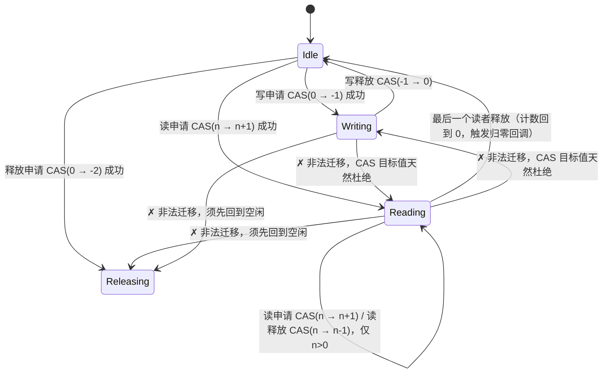
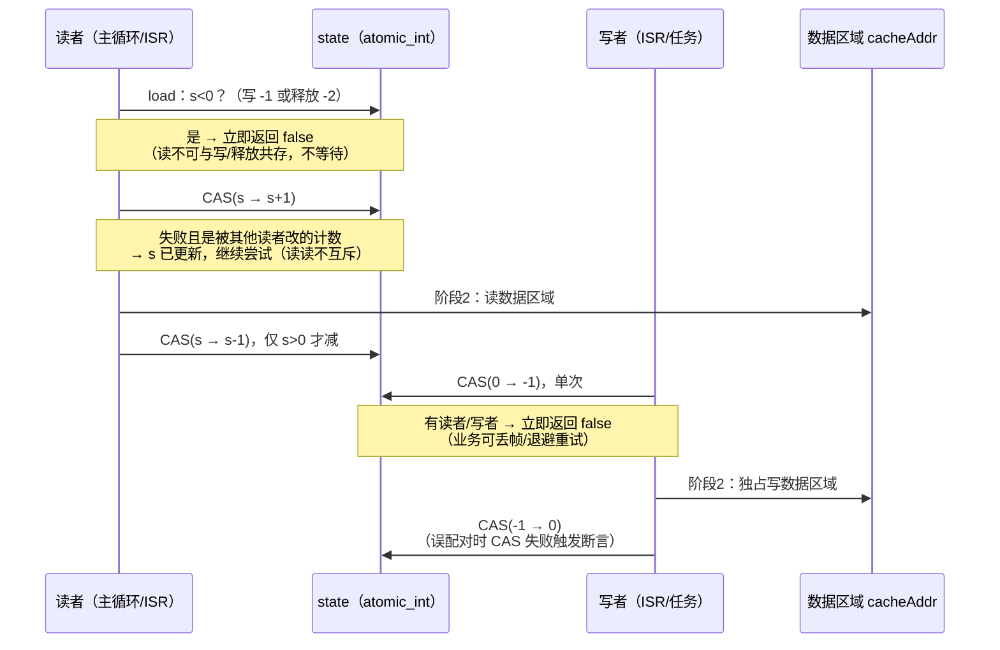

# Blackboard — 单原子整数保护的共享数据区域

Blackboard 是一个约 100 行、零依赖（仅需 C 标准库，核心为 C11 `<stdatomic.h>`）的共享数据保护组件。它解决这样一个需求：

> **一块数据区域（缓存）同时被多个读者和一个写者访问；读者可以同时读，写者必须独占写，读写绝不同时进行——而且任何一方申请访问时都不原地等待：申请成功才碰数据，申请失败立即返回，重试策略由调用方决定。**
>
> 数据区域的地址与大小就登记在模块结构体里，锁与数据同属一个对象，不存在"拿了 A 锁却改了 B 数据"的错位。

整个机制只有一个 `atomic_int`：值为 `0` 表示空闲，`-1` 表示正在被写，`-2` 表示释放状态（资源回收），大于 `0` 表示读者数量。不依赖任何 RTOS，不需要互斥锁、信号量，也不需要禁用中断。

---

## 使用特色

- **两步法访问**：无论读、写还是释放，都是"先申请状态更改，成功后再操作数据"。申请失败立即返回 `false`——写与释放申请都是单次 CAS；读申请只在读者间并发改计数时重试（读读不互斥，通常一两次即成功），**一旦遇到写者或释放状态立即失败，绝不循环等待**。
- **四态状态机**：空闲（0）、正在被写（-1）、正在被读（>0）、释放状态（-2）。空闲可与写、读互转，也可**单向**进入释放状态；读、写、释放两两不可直接切换——负值即独占，一次比较就能拦截。
- **固定读者 + 归零回调**：初始化时可设定读者初始值（`initReaderCount >= 0`，预登记读者数）与 `onReadersEmpty` 回调（结构体内联函数指针成员，可为 NULL）。类型命名为 `Blackboard_T`，标签为 `struct blackboard_t`，无需独立的回调 typedef。预期读者数目固定的场景下，各固定读者完成后直接归还计数，计数归零瞬间由最后一个归还者触发回调，适合"全部消费者读完后统一回收资源"。
- **ISR 友好**：申请不等待，因此可以在中断服务程序里直接使用。写者放在 ISR 里时，申请失败就丢弃本次更新，中断延迟不受任何影响。
- **互斥天然成立**：读申请的 CAS 目标是 `s → s+1`（先拦截 `s < 0`），写/释放申请的 CAS 目标是 `0 → -1` / `0 → -2`。"读、写、释放不能相互切换"不是检查出来的，而是 CAS 目标值决定的，不存在竞态窗口。
- **多读单写**：`state > 0` 即读者计数，天然支持任意多个读者并发；写者独占由 `-1` 单值保证。
- **锁与数据绑定**：`cacheAddr` / `cacheSize` 与 `state` 同处一个结构体，临界区内用 `cacheSize` 可做边界自检，且不参与状态机、零运行时开销。
- **无锁无障碍**：全部状态迁移都是原子操作，临界区再短也不用 `__disable_irq()`，最高优先级中断的响应不受影响。
- **极小 footprint**：单 `.c` 单 `.h`，无堆分配，无后台上下文，初始化仅为几次赋值、无循环无分配。Cortex-M（ARMv7-M 及以上）上 CAS 由编译器自动降为 `LDREXW/STREXW` 排他指令。

## 实现原理

四态状态机，全部迁移经 CAS 完成：



### 两步法时序（关键在"申请失败不等待"）



### 为什么读/写/释放不能相互切换是自然成立的

```text
写或释放进行中（state = -1 或 -2，即 s < 0）：
    读申请先判 s < 0 直接拒绝 —— CAS 根本没有机会执行
读进行中（state = n > 0）：
    写申请 CAS(0 → -1) / 释放申请 CAS(0 → -2) 与当前值 n 不匹配 —— 必然失败
写与释放之间：
    两者期望值都是 0，当前值为另一个负值 —— CAS 必然失败
所有"非法迁移"都无法通过 CAS 的目标值检查，互斥无需任何额外判断。
```

## 使用方法

### 1. 集成

把 `Inc/blackboard.h`、`Src/blackboard.c` 加入工程，include 路径加入 `Inc`。编译器需开启 C11（GCC/Clang `-std=c11`，Keil AC6 `--c11`）。

> **提示**：`blackboard.c` 中的 `assert` 依赖 `<assert.h>`；量产固件定义 `NDEBUG` 后断言消失，仅剩原子指令本身。

### 2. API

| API | 说明 |
| --- | --- |
| `void BlackboardInit(Blackboard_T *bb, void *cacheAddr, size_t cacheSize, int initReaderCount, void (*onReadersEmpty)(Blackboard_T *))` | 初始化：登记数据区域，设定读者初始值（必须 ≥ 0，>0 用于预期读者数目固定的场景）与归零回调（可为 NULL）。黑板对象使用前必须经本函数初始化。 |
| `bool BlackboardReadRequest(Blackboard_T *bb)` | 阶段1：申请读。成功返回 `true`；有写者或释放状态时立即返回 `false`（读者间 CAS 竞争会自动重试）。 |
| `bool BlackboardWriteRequest(Blackboard_T *bb)` | 阶段1：申请写。单次 CAS，仅空闲时成功，否则立即返回 `false`。 |
| `bool BlackboardFreeRequest(Blackboard_T *bb)` | 阶段1：申请进入释放状态（-2）。单次 CAS，仅空闲时成功；用于资源回收/下线，期间所有读写申请均失败。 |
| `void BlackboardReadRelease(Blackboard_T *bb)` | 阶段2之后：释放读。计数归零时触发 `onReadersEmpty` 回调。仅申请成功者（或固定读者场景归还预登记计数）调用，必须配对。 |
| `void BlackboardWriteRelease(Blackboard_T *bb)` | 阶段2之后：释放写（CAS 实现，误配对触发断言）。仅申请成功者调用。 |

### 3. 示例（来自 `_example`：SysTick 写者 + 主循环/按键读者）

```c
#include "blackboard.h"

typedef struct { uint32_t seq; uint32_t tick; int16_t acc[3]; } SensorFrame;

static SensorFrame gFrame;
static Blackboard_T gBlackboard;

/* main() 中外设初始化之后：*/
BlackboardInit(&gBlackboard, &gFrame, sizeof gFrame, 0, NULL);

/* SysTick ISR 写者：申请失败直接丢帧，绝不在 ISR 里等待 */
void Blackboard_SysTickWriter(void)
{
    if (BlackboardWriteRequest(&gBlackboard)) {
        SensorFrame *f = (SensorFrame *)gBlackboard.cacheAddr;
        f->seq++;  f->tick = HAL_GetTick();
        BlackboardWriteRelease(&gBlackboard);
    }
}

/* 主循环读者：申请成功才碰数据，失败下一轮再来 */
while (1) {
    if (BlackboardReadRequest(&gBlackboard)) {
        SensorFrame copy;
        memcpy(&copy, gBlackboard.cacheAddr, gBlackboard.cacheSize);
        BlackboardReadRelease(&gBlackboard);
        printf("seq=%lu\n", (unsigned long)copy.seq);
    }
    HAL_Delay(500);
}
```

效果：读者要么看到完整的上一帧、要么看到完整的下一帧，帧序号严格递增无撕裂；写者遇到读者时丢帧而不阻塞，1kHz SysTick 的节奏不受影响。

### 4. 约束与注意事项

- **申请/释放必须严格配对**：申请失败的一方不得触碰数据区域，也不得调用 Release。防误配对有双重兜底：读释放仅当计数 > 0 才减 1（CAS 保护，多释放不会把计数减成负数），写释放用 CAS 实现（未持有写锁调用会断言失败）。唯一的例外是固定读者场景：预登记读者的计数由初始化垫付，归还时直接 `BlackboardReadRelease`，无需先 Request。
- **回调上下文**：`onReadersEmpty` 在最后一个归还者的上下文里同步调用，应尽快返回；回调中可对同一黑板申请写/释放（此时 state 已为 0），但不要递归归还计数。
- **释放状态是单向终态**：进入 -2 后不再回到空闲，黑板对后续访问永久关闭（无需也不存在 Finish 操作）；只适合"回收后黑板即废弃"的场景，临时下线请勿使用本状态。
- **不可重入**：同一线程重复申请写会返回 `false`（不会死锁）；读者重复申请会多计一次数，释放次数必须对应。
- **写者饥饿**：读者络绎不绝时写申请可能持续失败。对写实时性敏感的场景，由上层给写者加退避重试配额，或压缩一个"写等待"标志位进 `state`（如 bit31）让读者让行。
- **临界区要短**：模块本身无等待，但持锁时间越长，对方的失败率越高。建议临界区内只做 `memcpy` 级别的整帧搬运，耗时操作移出临界区。
- **读者计数上限**：`state` 为 `int`，理论上限 `INT_MAX` 个并发读者，实际不会触及。

## 目录结构

```text
Blackboard/
├── Inc/blackboard.h       对外 API（结构体、初始化与五个操作函数）
├── Src/blackboard.c       实现（C11 原子操作，含断言加固）
└── _example/              STM32H563 Nucleo 演示代码
    └── Core/Src/main.c    SysTick 写者 + 主循环/按键读者示例
```

## License

见仓库根目录 LICENSE。
